<p align="center"></p>

<h1 align="center">The booking form</h1>

<p align="center"><strong>Quote first, then book. On any site, from one line of code.</strong></p>

<p align="center">
  <a href="https://bookingmachine.io/features/widget">Widget</a> ·
  <a href="https://bookingmachine.io/features/pricing-engine">Pricing</a> ·
  <a href="https://bookingmachine.io/help">Help</a> ·
  <a href="../README.md">Back to the tour</a>
</p>

The booking form is what your customers use. It shows your services, works out a real price from the options they choose, offers only the times you are free, and takes the booking. It is the same form whether it sits on your website, behind a link or a QR code, or on the site BookingMachine hosts for you.

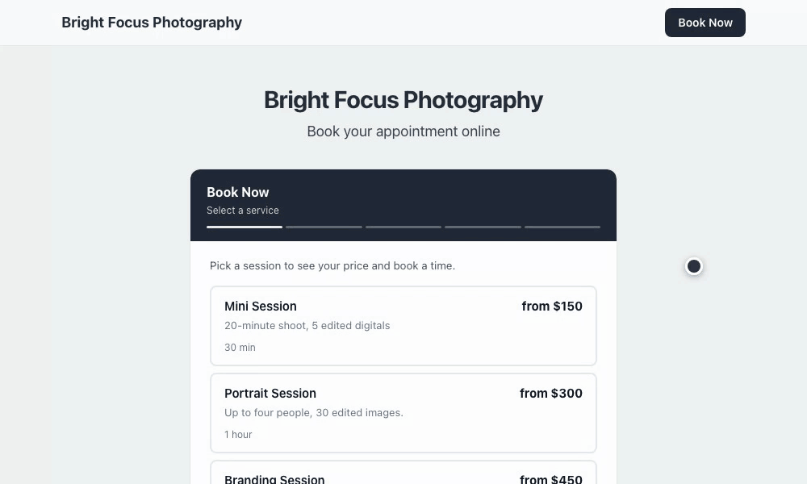

Every screen below is from a demo business called Bright Focus Photography, filled with made-up customers and numbers. Nothing here is a mock-up.

## What the customer does, step by step

<table>
  <tr>
    <td width="50%">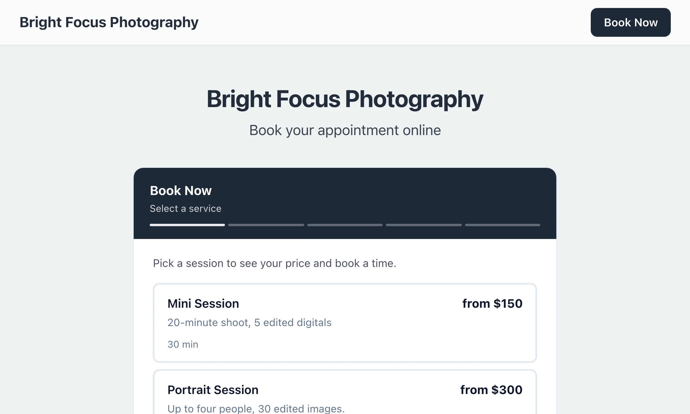</td>
    <td width="50%">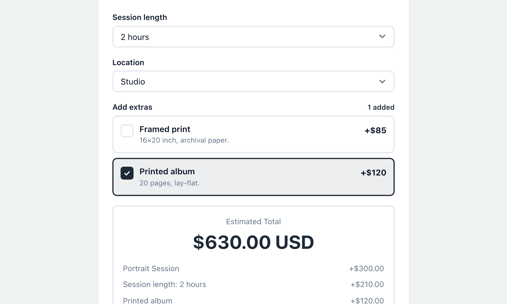</td>
  </tr>
  <tr>
    <td>One. Pick a service. Each one shows its starting price and how long it takes.</td>
    <td>Two. Choose the options. The total and its breakdown change with every choice.</td>
  </tr>
  <tr>
    <td width="50%">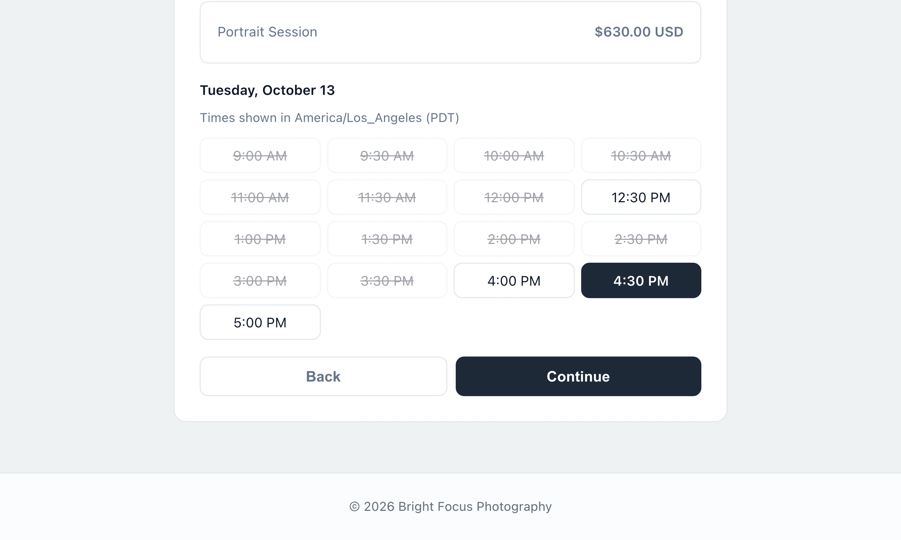</td>
    <td width="50%">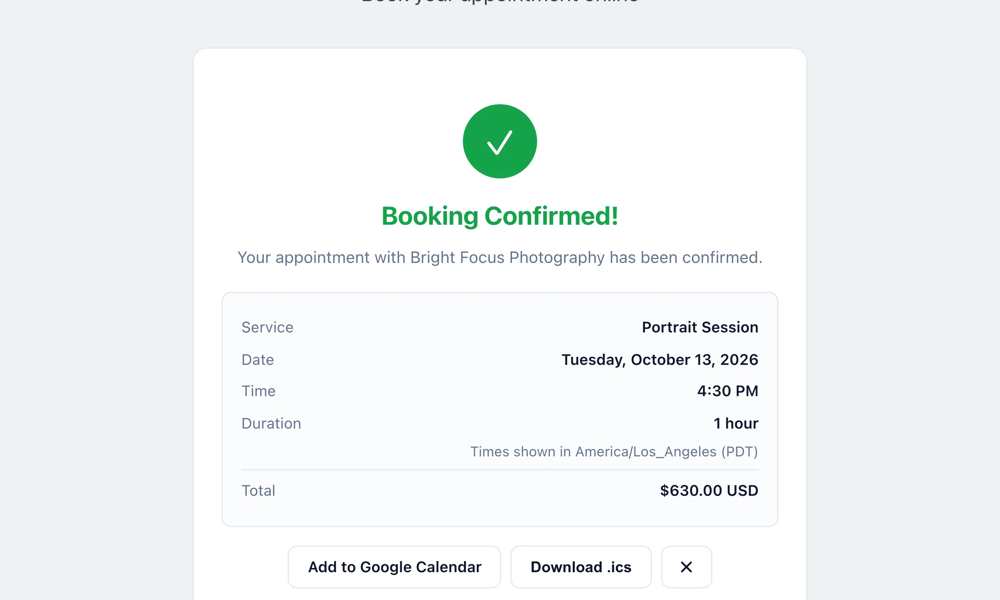</td>
  </tr>
  <tr>
    <td>Three. Pick a day and a time. Times that are taken cannot be picked.</td>
    <td>Four. After their name and contact details, the booking is confirmed on the spot.</td>
  </tr>
</table>

If the business takes payment online, a card step sits between the details and the confirmation. The demo business here does not, so its bookings confirm straight away.

<p align="center">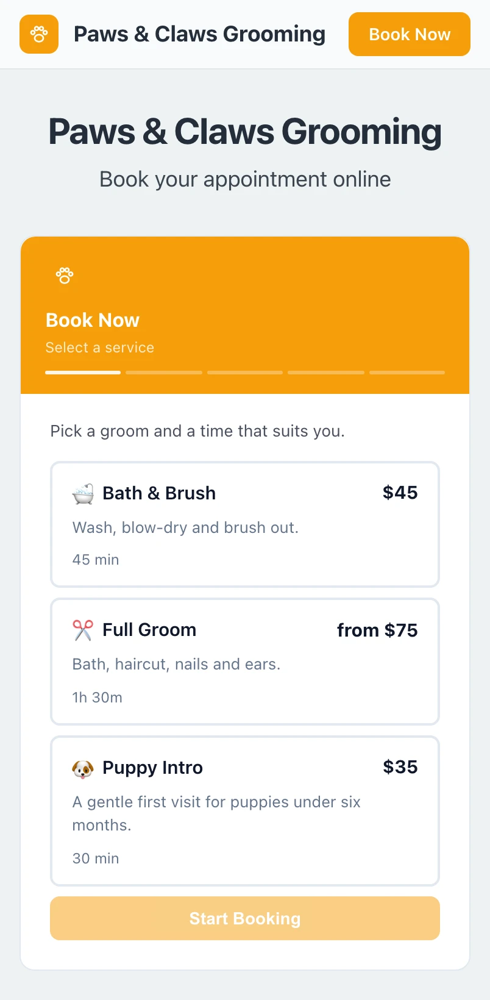</p>

<p align="center">The same form on a phone, in another business's colours.</p>

## Building what it shows

Everything on the form comes from four screens in the dashboard.

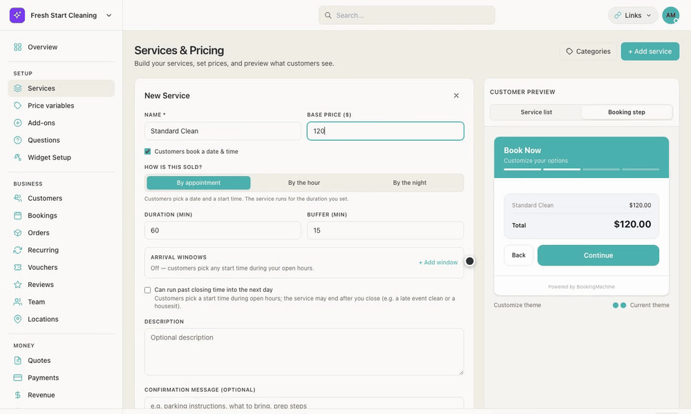

<table>
  <tr>
    <td width="50%">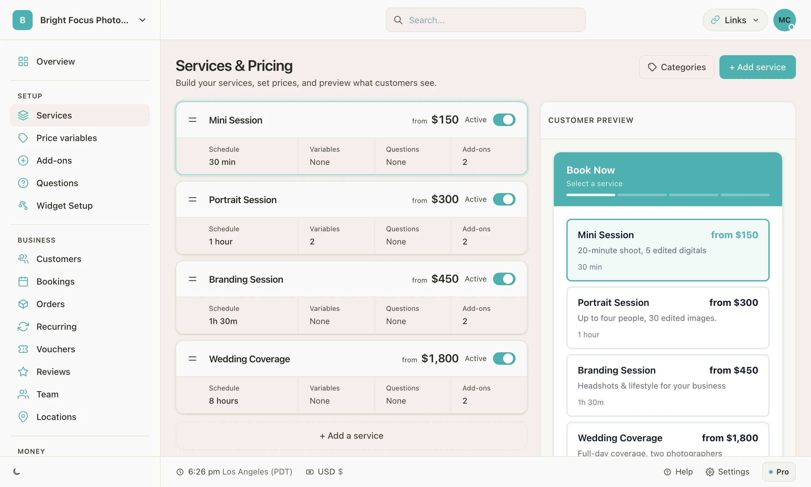</td>
    <td width="50%">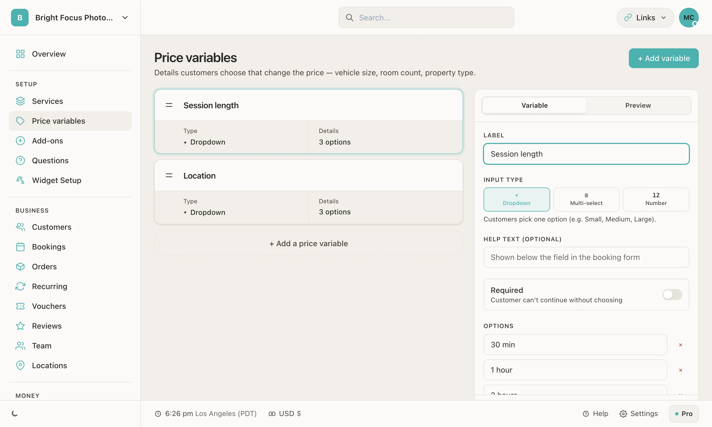</td>
  </tr>
  <tr>
    <td>Services and Pricing. The preview on the right is the real form.</td>
    <td>Price variables. A question whose answer changes the price.</td>
  </tr>
  <tr>
    <td width="50%">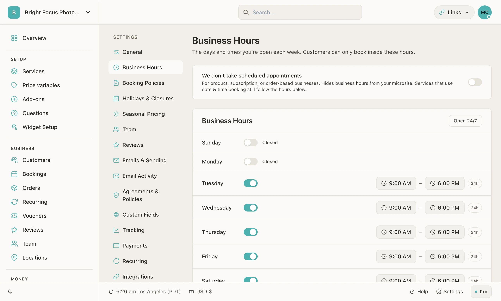</td>
    <td width="50%">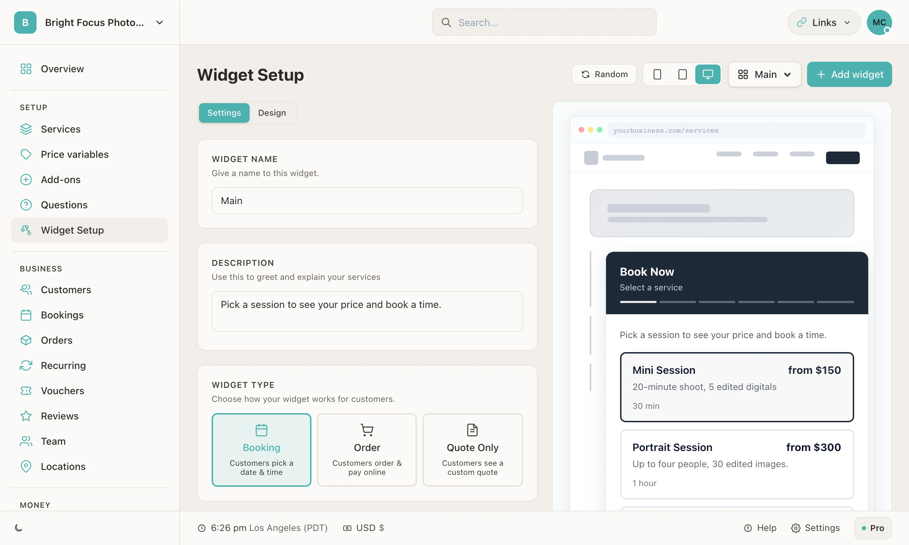</td>
  </tr>
  <tr>
    <td>Business Hours. The form only offers times inside them.</td>
    <td>Widget Setup. Its wording, its look and what kind of form it is.</td>
  </tr>
</table>

## How the price is worked out

- **A base price** for the service.
- **Price variables.** Each option of a variable gets its own price, and a service can use several variables at once.
- **Extras.** Add-ons the customer can tick, each with its own price.
- **Rules.** Seasonal prices and prices by the night or by the hour, for the businesses that need them.
- **The same sum on both sides.** The form works the price out as the customer chooses, and the server works it out again when the booking is made, so the price shown is the price charged.

## Putting it on a site

```html
<script src="https://bookingmachine.io/embed.js" data-business="your-slug" async></script>
```

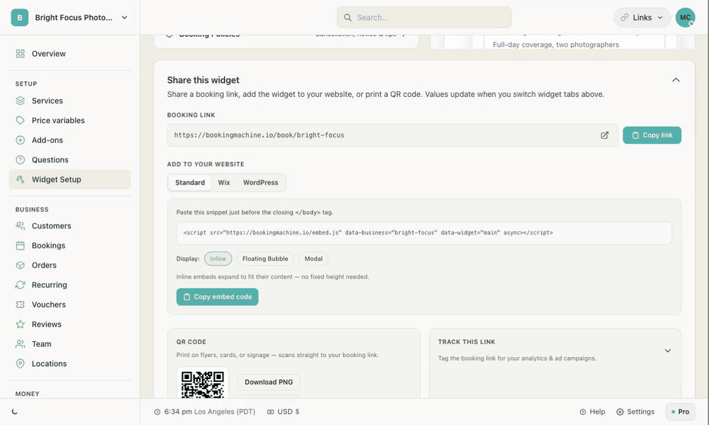

<table>
  <tr>
    <td width="50%">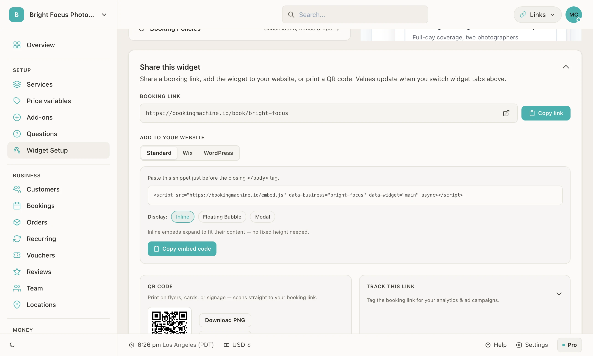</td>
    <td>
      <strong>Inline</strong> draws the form where the snippet sits.<br><br>
      <strong>Floating Bubble</strong> adds a button to the corner of every page.<br><br>
      <strong>Modal</strong> opens the form over the page when a button is pressed.<br><br>
      The form keeps its styles to itself, so the page around it cannot change how it looks.
    </td>
  </tr>
</table>

## The guides

**Start here:** [Quickstart](quickstart.md) · [Platform guides](platform-guides.md)

**Go further:** [Widget reference](widget-reference.md) · [Analytics](analytics.md) · [API reference](api-reference.md)

**In the help centre:** [bookingmachine.io/help](https://bookingmachine.io/help)

<p align="right"><a href="../README.md">Back to the tour →</a></p>
