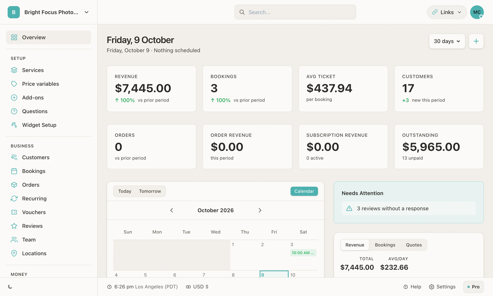
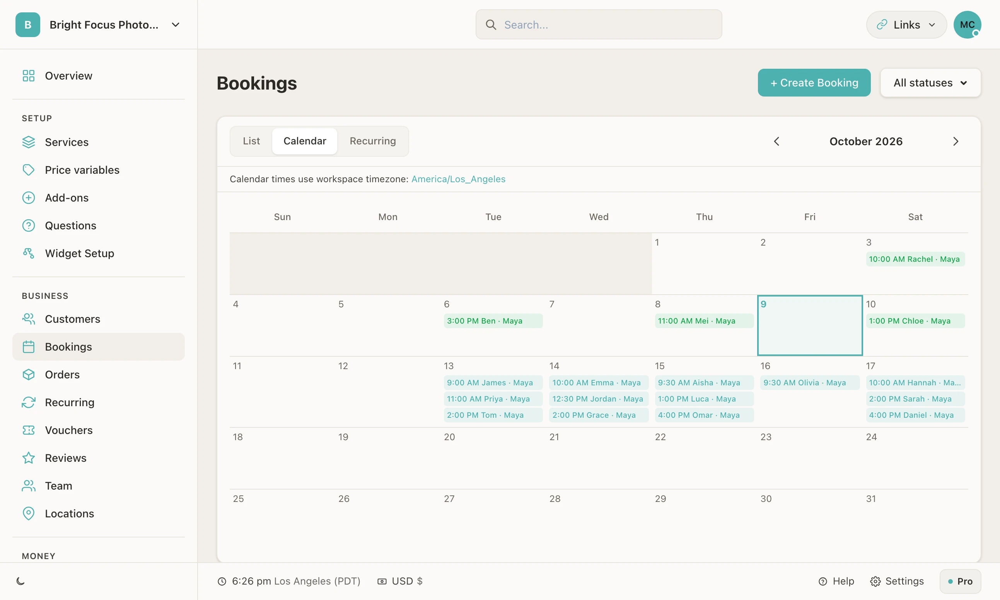
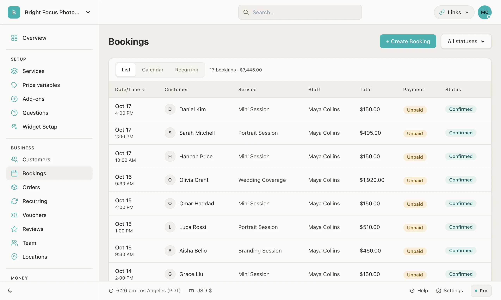
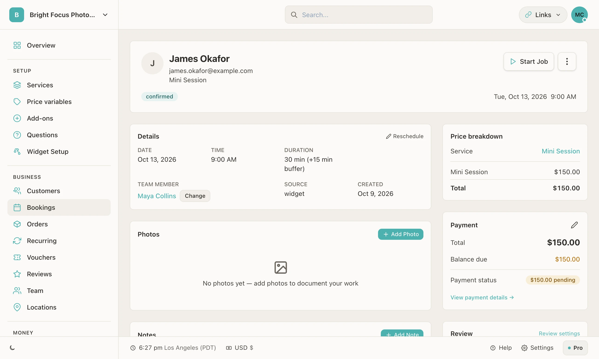
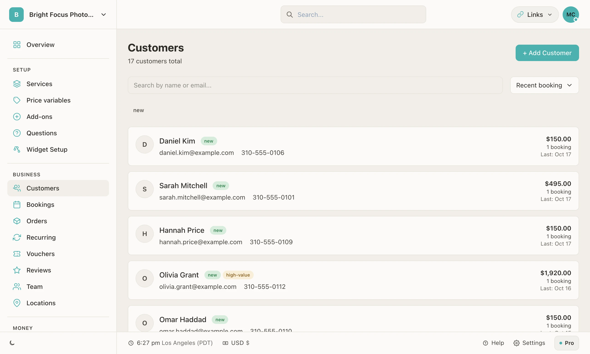

<h1 align="center">The dashboard</h1>

<strong>Every booking, customer and payment in one place.</strong>

  <a href="https://bookingmachine.io/features/scheduling">Scheduling</a> ·
  <a href="https://bookingmachine.io/features/crm">Customers</a> ·
  <a href="https://bookingmachine.io/features/payments">Payments</a> ·
  <a href="../README.md">Back to the tour</a>

The dashboard is where the owner works. A booking made on the form shows here the moment it is made, with its price, its payment and the customer it belongs to. It runs in a browser on a desk or a phone.

Every screen below is from a demo business called Bright Focus Photography, filled with made-up customers and numbers. Nothing here is a mock-up.

## The overview

<table>
  <tr>
    <td width="50%"></td>
    <td width="50%"></td>
  </tr>
  <tr>
    <td>What has come in, what is owed and what needs a reply, for the period you choose.</td>
    <td>The month at a glance. Each entry opens its booking.</td>
  </tr>
</table>

## Bookings

<table>
  <tr>
    <td width="50%"></td>
    <td width="50%"></td>
  </tr>
  <tr>
    <td>Filter by status, switch to the calendar, or add a booking taken by phone.</td>
    <td>One job on one screen: start it, complete it, add photos and notes.</td>
  </tr>
</table>

- **Start and complete.** A booking moves from confirmed to in progress to completed. Completing it is what sends the review request.
- **Change it.** Staff can move a booking to another time or another team member.
- **Add your own.** A booking taken by phone or in person goes in through Create Booking.

## Customers

<table>
  <tr>
    <td width="50%"></td>
    <td>
      Nobody types a customer in. A booking, a quote or an enquiry on the form makes the record, and every later booking adds to it.  
      Tags such as <strong>new</strong>, <strong>returning</strong> and <strong>high-value</strong> are worked out from what each customer has booked and spent.
    </td>
  </tr>
</table>

## Getting paid

- **Online, through Stripe.** Connect your own Stripe account and each service can take a deposit or the full amount when it is booked. The money goes to you.
- **Or not at all.** A form can take bookings with no payment, and you settle up on the day.
- **Know what is owed.** Each booking shows what has been paid and what is outstanding, and the overview adds it up.

Plans that include online payments are on the [pricing page](https://bookingmachine.io/pricing).

## More than bookings

| Part | What it does |
| --- | --- |
| [Quotes](https://bookingmachine.io/features/quotes) | Send a price for a custom job; the customer accepts it online |
| [Invoices](https://bookingmachine.io/features/invoicing) | Bill for work done, with a page the customer pays from |
| [Recurring](https://bookingmachine.io/features/recurring) | Put a regular customer on a repeating schedule |
| [Vouchers](https://bookingmachine.io/features/vouchers) | Voucher codes a customer can use when they book |
| [Team](https://bookingmachine.io/features/team-management) | Add team members and assign each booking to one of them |
| [Locations](https://bookingmachine.io/features/multi-location) | Run more than one branch from one account |
| [Documents](https://bookingmachine.io/features/professional-documents) | Agreements and policies a customer accepts when they book |

<a href="../README.md">Back to the tour →</a>

