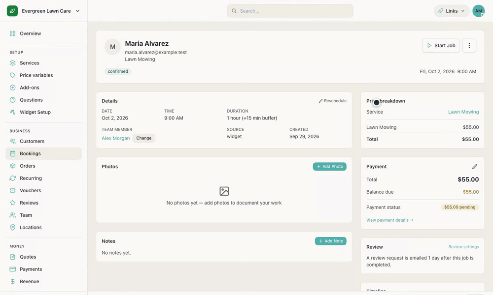
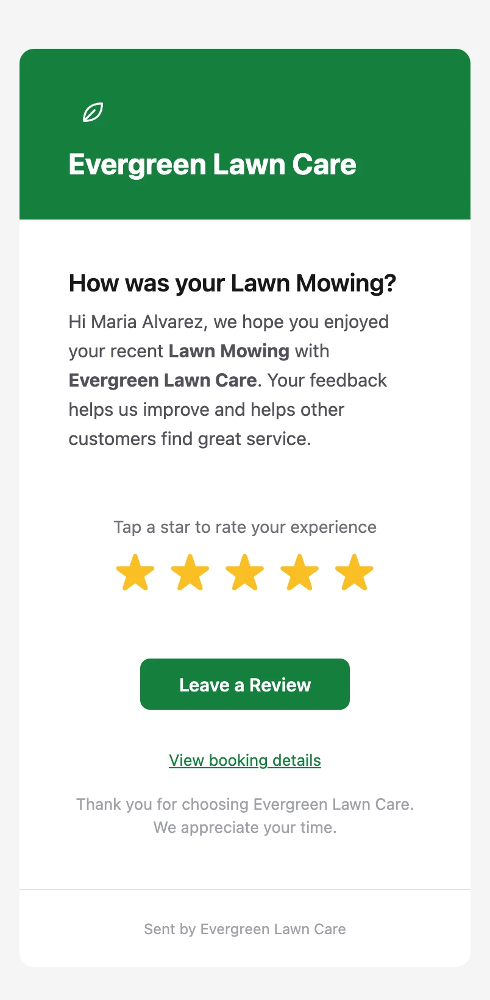
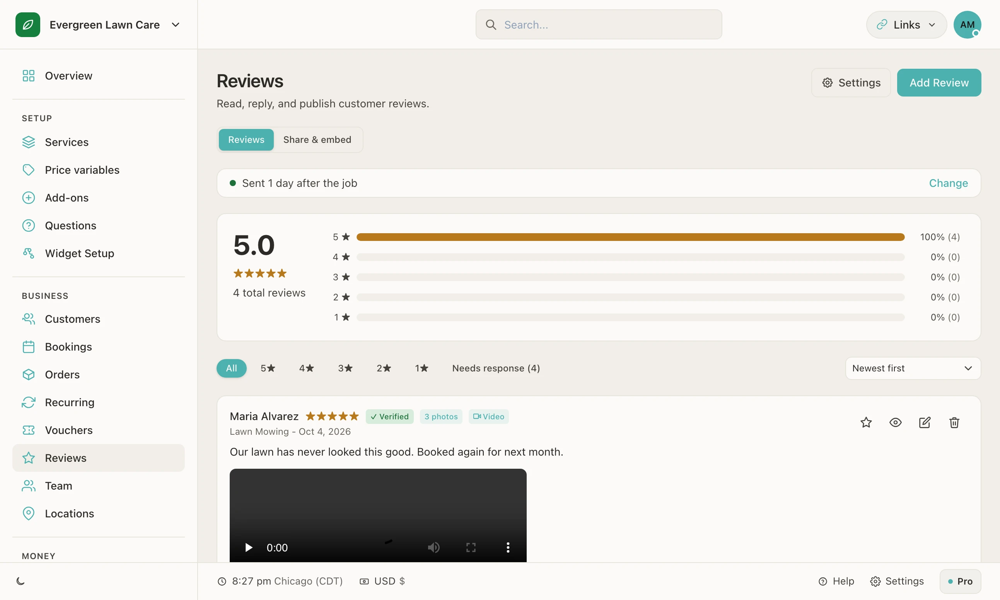
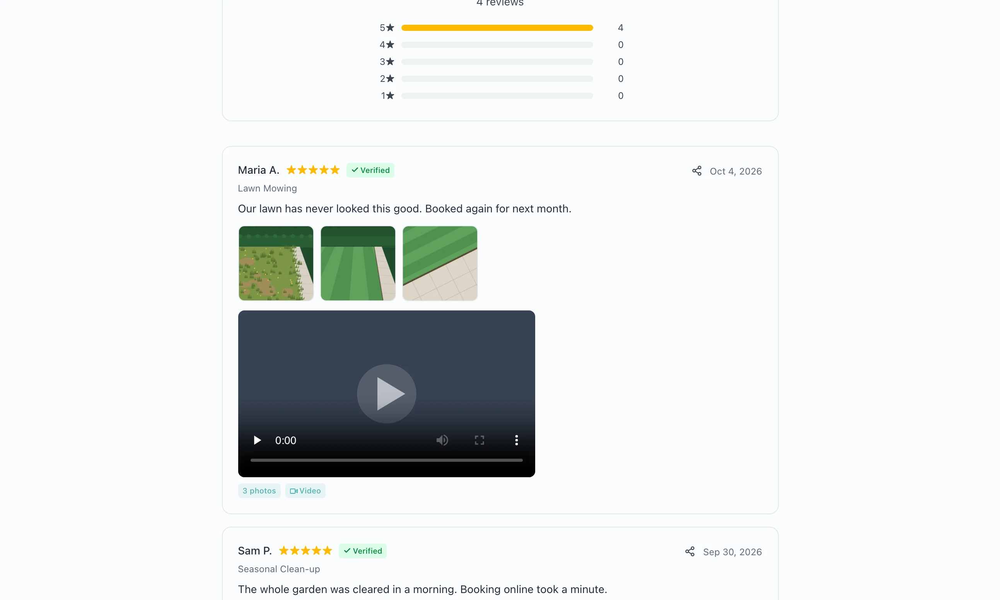
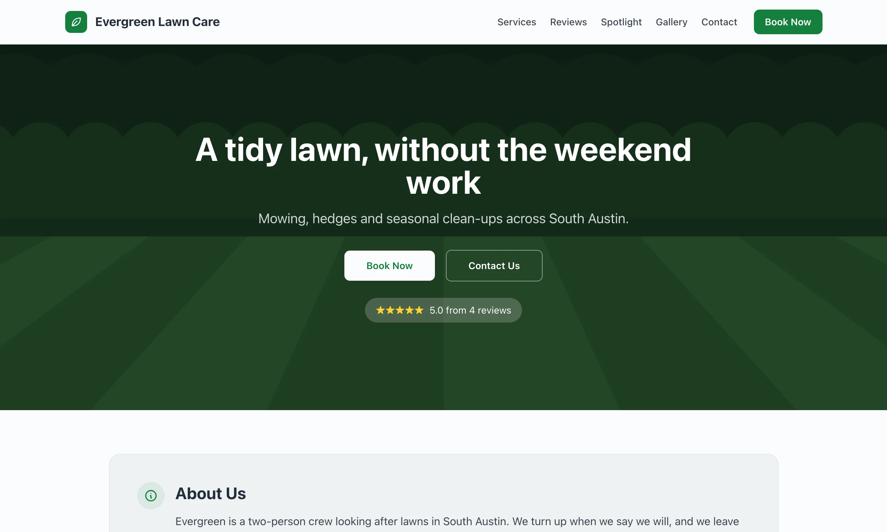
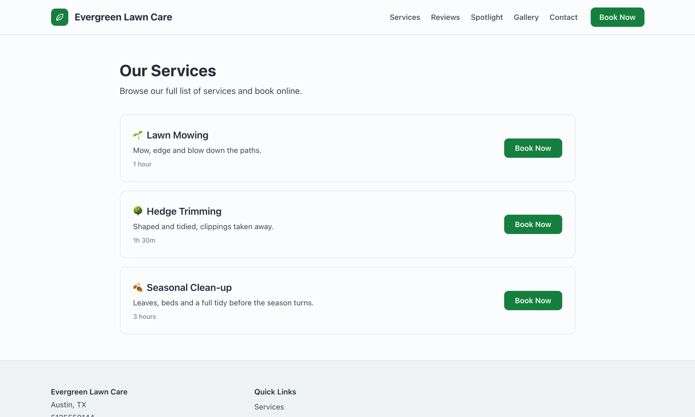

<h1 align="center">Reviews and the hosted site</h1>

<strong>Finish the job and the review asks for itself.</strong>

  <a href="https://bookingmachine.io/reviews">Reviews</a> ·
  <a href="https://bookingmachine.io/microsite">Hosted site</a> ·
  <a href="https://bookingmachine.io/link">Booking link</a> ·
  <a href="../README.md">Back to the tour</a>

Reviews are how a local business gets its next customer, and most never get asked for. BookingMachine asks every time. When a job is marked complete, the customer is emailed a request, their review lands in the dashboard, and it shows on a public page and anywhere you embed the reviews widget.

Every screen below is from a demo business called Evergreen Lawn Care, filled with made-up customers and reviews. Nothing here is a mock-up.

## From finished job to public review

<table>
  <tr>
    <td width="34%" align="center"></td>
    <td>
      <strong>One.</strong> You mark the booking complete.  
      <strong>Two.</strong> The customer gets this email, a day later by default. You choose the delay.  
      <strong>Three.</strong> They tap a star and write as much or as little as they like.  
      <strong>Four.</strong> The review shows in your dashboard, marked as verified because it came from a real booking.
    </td>
  </tr>
</table>

<table>
  <tr>
    <td width="50%"></td>
    <td width="50%"></td>
  </tr>
  <tr>
    <td>Read, reply and publish. A filter shows the reviews still waiting for a reply.</td>
    <td>The public reviews page. Anyone can also leave a review from here.</td>
  </tr>
</table>

- **A page of their own.** Every business has a public reviews page to link to.
- **A widget for your site.** One script tag shows your reviews on your own website, the same way the booking form is embedded.
- **Your reply beside the review.** A response from the business shows under the review it answers.

## The hosted site

A business with no website still needs somewhere to send people. The hosted site is a small, fast website made from what is already in the dashboard: the services, the reviews, the photos and the contact details.

<table>
  <tr>
    <td width="50%"></td>
    <td width="50%"></td>
  </tr>
  <tr>
    <td>The home page: your headline, your colours and your rating.</td>
    <td>Services, each with a Book Now button that opens the booking form.</td>
  </tr>
</table>

- **Made from the dashboard.** Change a service or get a new review and the site changes with it.
- **Book Now on every page.** It opens the same booking form as everywhere else.
- **On your own domain.** The site can answer on a domain you own.

<a href="../README.md">Back to the tour →</a>

